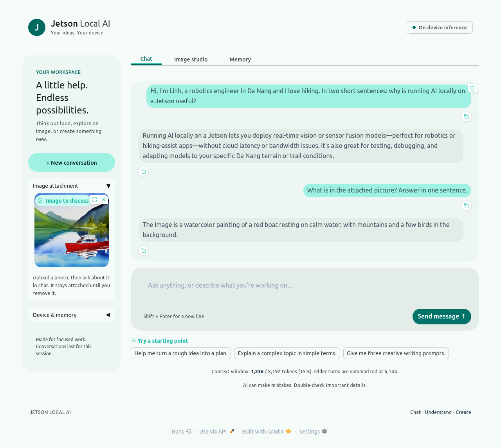

# Jetson Local AI

A private, fully on-device AI workspace for NVIDIA Jetson: **chat**, **image understanding** and **image generation** in one web page. No cloud, no API keys, nothing leaves the device.



The UI follows Material Design 3 (light, dark and phone layouts).

| Feature | Engine | Model |
| --- | --- | --- |
| Chat + describe uploaded images | [Ollama](https://ollama.com) | `huihui_ai/qwen3-vl-abliterated:4b-instruct` (3.3 GB) |
| Text-to-image, 512×512 | [stable-diffusion.cpp](https://github.com/leejet/stable-diffusion.cpp) built with CUDA (SM87) | Stable Diffusion 1.5 (4 GB) |
| Long-term memory | [Mem0](https://github.com/mem0ai/mem0) (open source, runs locally) | `nomic-embed-text` embeddings (274 MB) + the chat model, stored in `memory_db/` |
| Web UI | [Gradio](https://gradio.app) 6 | `app.py`, `memory.py`, `config.py` |

Tested on a **Jetson Orin NX 16 GB** (reComputer J401, JetPack 6.2 / L4T R36.4.3, NVMe SSD, 25 W mode). Measured speed: **about 8 tokens/s** chat, **about 2.1 s per diffusion step** (a 20-step image in about 49 s). Full write-up with screenshots and charts: **[docs/blog.md](docs/blog.md)**.

## Quick start

Requirements: Jetson Orin (JetPack 6, CUDA 12.x), Ollama installed, about 10 GB free disk, internet for the first install.

```bash
git clone <your-repo-url> local-ai && cd local-ai
bash scripts/install.sh          # venv, models, CUDA build, systemd user service (about 20-40 min the first time)
```

Open <http://127.0.0.1:7860>.

Manual run without systemd: `venv/bin/python app.py`

## Configuration

Everything is an environment variable (see `config.py`):

| Variable | Default | Meaning |
| --- | --- | --- |
| `LOCAL_AI_HOST` | `127.0.0.1` | Set `0.0.0.0` to reach it from other devices. **There is no login**, so only do this on a trusted network. |
| `LOCAL_AI_PORT` | `7860` | Web port |
| `LOCAL_AI_CHAT_MODEL` | `huihui_ai/qwen3-vl-abliterated:4b-instruct` | Any Ollama vision-capable model |
| `LOCAL_AI_NUM_CTX` / `LOCAL_AI_NUM_PREDICT` | `8192` / `1024` | Context window / max answer tokens |
| `LOCAL_AI_KEEP_ALIVE` | `3m` | How long chat stays in memory when idle |
| `LOCAL_AI_AUTH` | unset | `user:password` to require a login |
| `LOCAL_AI_MAX_QUEUE` | `20` | Requests allowed to wait for the GPU |
| `LOCAL_AI_MEMORY` | `1` | `0` turns long-term memory off |
| `LOCAL_AI_MEMORY_DIR` | `./memory_db` | Where memories are stored |
| `LOCAL_AI_EMBED_MODEL` | `nomic-embed-text` | Ollama embedding model for memory |
| `LOCAL_AI_COMPACT_RATIO` / `LOCAL_AI_COMPACT_KEEP` | `0.75` / `4` | When to summarize, and how many recent messages to keep |

## Memory and long conversations

- **Long-term memory (Mem0, local).** After each message the chat model extracts lasting facts about you (name, job, preferences, allergies, things you ask it to remember) and stores them in an on-disk vector database (`memory_db/`). Before each reply, the most relevant facts are recalled and given to the model. Nothing leaves the device; Mem0 telemetry is turned off.
- **See and edit it.** Open the **Memory** tab to list everything saved, delete one memory, or forget everything (needs a confirmation tick). The same tab has the on/off switch.
- **Compaction.** The chat tracks real token use (shown under the chat box). When the conversation reaches 75% of the context window (`LOCAL_AI_COMPACT_RATIO`), older turns are replaced by a short summary and the last 4 messages (`LOCAL_AI_COMPACT_KEEP`) stay word for word. A notice appears in the chat.
- Memory extraction runs in the background after a reply and uses the GPU for several seconds, so a message sent right away may wait briefly.
- The 4B model sometimes stores slightly overlapping facts; near-identical duplicates are removed automatically, others can be deleted in the Memory tab.
- Turn memory off for good with `LOCAL_AI_MEMORY=0`; move the data folder with `LOCAL_AI_MEMORY_DIR`.

## Share on your local network

Default is this device only. To allow other devices on your Wi-Fi/LAN, run `systemctl --user edit local-ai`, add

```ini
[Service]
Environment=LOCAL_AI_HOST=0.0.0.0
Environment=LOCAL_AI_AUTH=myuser:a-long-password   # optional login (plain HTTP, so only a latch)
```

then `systemctl --user restart local-ai` and open `http://<jetson-ip>:7860` (`hostname -I`). Never forward the port to the internet. Many devices can open the page at once (200 simultaneous loads tested), but GPU jobs run one at a time in a queue (`LOCAL_AI_MAX_QUEUE`, default 20; extra requests get "Queue is full"). Details and measurements: [docs/blog.md](docs/blog.md).

## Operate

```bash
systemctl --user status|start|stop|restart local-ai
bash scripts/start.sh / scripts/stop.sh
tail generation.log                      # last image-generation log
```

## Test and benchmark

```bash
venv/bin/python scripts/smoke-test.py    # API checks: vision, memory, image generation (about 1 min)
venv/bin/python scripts/benchmark.py     # speed, RAM, GPU, power -> docs/benchmark-results.json
python3 scripts/make-charts.py           # needs matplotlib
venv/bin/python scripts/concurrency-test.py   # simultaneous clients and queue behaviour
# UI test: use a throwaway instance so test chats do not land in your real memory
LOCAL_AI_PORT=7863 LOCAL_AI_MEMORY_DIR=/tmp/ai-test-mem venv/bin/python app.py &
pip install selenium && LOCAL_AI_TEST_URL=http://127.0.0.1:7863 python3 scripts/ui-test.py   # saves docs/images/*.png
```

## Layout

```
app.py            Gradio app: chat, vision, image studio, memory tab
memory.py         Mem0 wrapper: recall, remember, list, delete
config.py         settings and the stable-diffusion command line
ui.css            interface styling
scripts/          install, start/stop, service file, tests, benchmark
docs/             blog.md, benchmark data, device info, screenshots, original build log
```

## Notes and limits

- One GPU job at a time: chat is unloaded before an image is made (a conservative choice that keeps memory headroom; concurrent use was not tested). Switching back costs a model load (about 6 s).
- The chat model is "abliterated" (fewer refusals). No extra content filter is added. You are responsible for how you use it.
- Model weights are not in this repository; `install.sh` downloads them from Ollama and Hugging Face under their own licenses.

## License

[MIT](LICENSE) for this project's code. The downloaded models (Qwen3-VL, Stable Diffusion 1.5) and stable-diffusion.cpp have their own licenses.
