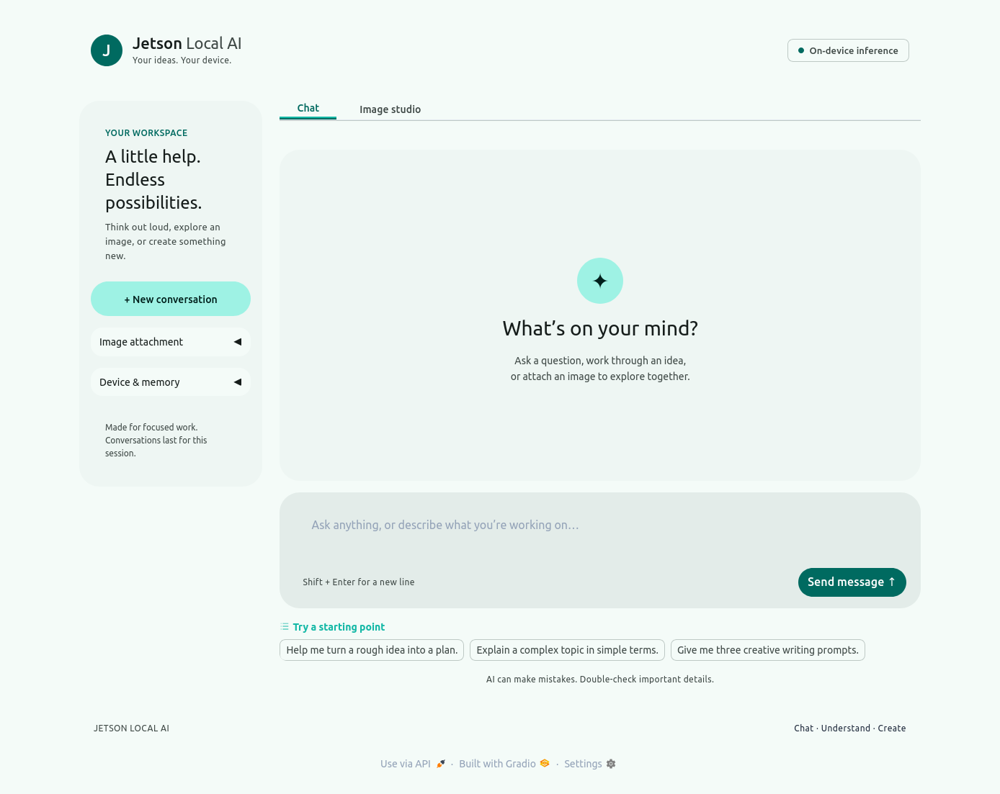
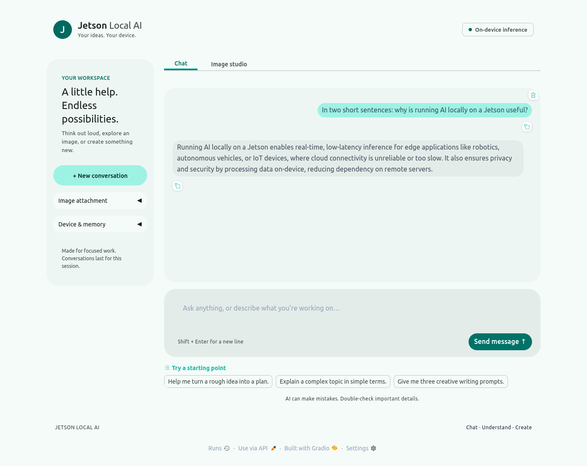
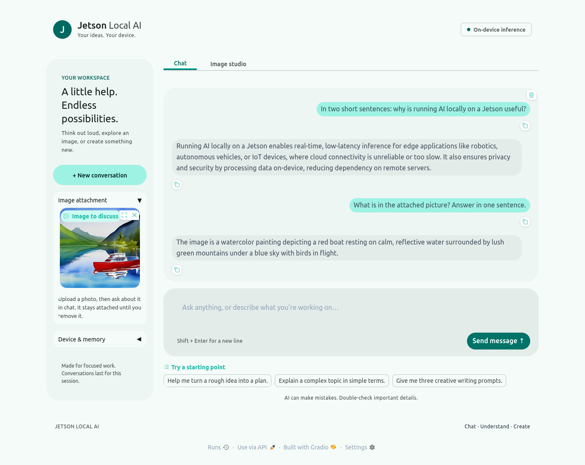
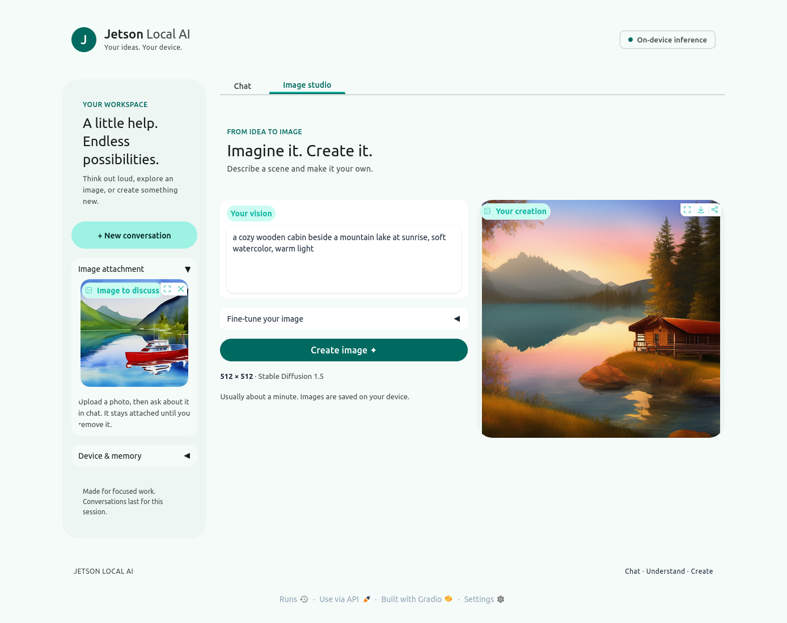
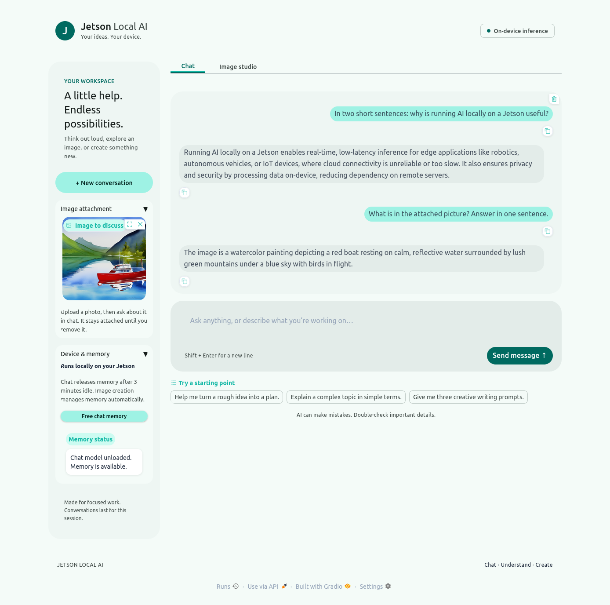
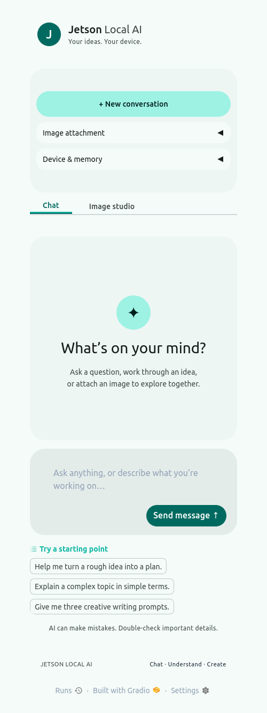
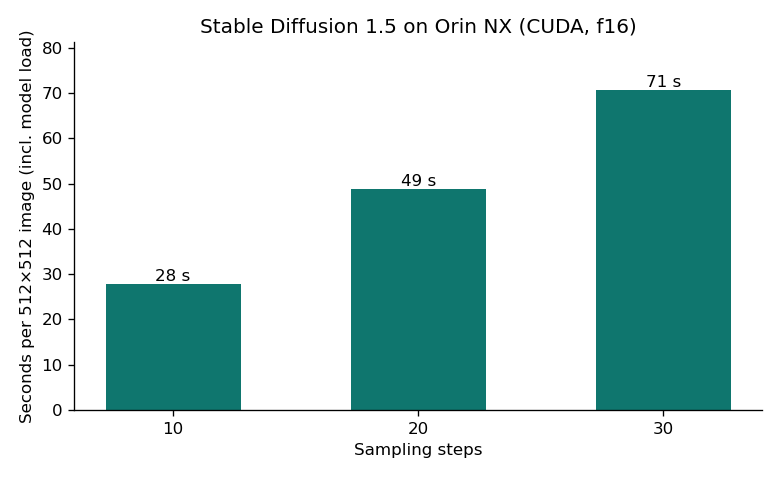
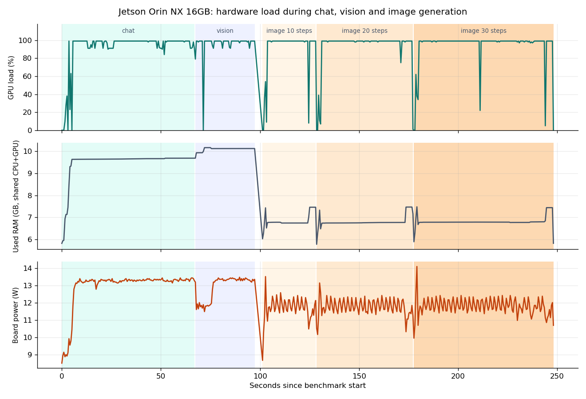
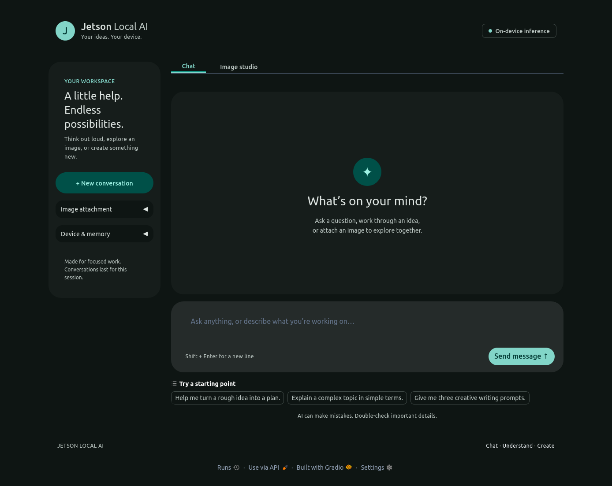

# I built a private ChatGPT-style AI (chat, vision and image generation) on a Jetson, with no cloud

*Everything below ran on one small board: no cloud, no API key. Every number comes from a measurement I ran on the device, and the raw data is in this repo.*



## TL;DR

| | |
| --- | --- |
| Device | NVIDIA Jetson **Orin NX 16 GB** (reComputer J401), JetPack 6.2, NVMe SSD (ADATA LEGEND 900, 477 GB), 25 W power mode |
| Chat + image understanding | Qwen3-VL 4B (Ollama), about **8 tokens/s**, about 6 s cold load |
| Image generation | Stable Diffusion 1.5 at 512×512 (CUDA), about **2.1 s per step**: 10 steps = 28 s, 20 steps = 49 s, 30 steps = 71 s |
| Power / temperature | about 12-13 W for the whole board, 62.5 °C peak junction temperature |
| Memory | 10.4 GB peak while chatting with an image, 7.7 GB while generating (out of 15.6 GB shared) |
| Models | Qwen3-VL 4B Q4_K_M (3.3 GB) for chat + vision, Stable Diffusion 1.5 (2.1 GB in memory) for images |
| Network | open to the LAN with one setting; 200 simultaneous page loads OK, GPU jobs run one at a time |
| Code | one 190-line Python file plus a CUDA build of stable-diffusion.cpp |

> **A correction about the hardware.** I started this as "Jetson Xavier NX 16 GB", but the board reports itself as **Orin NX 16 GB** (`/proc/device-tree/model`, L4T R36.4.3, CUDA compute capability 8.7). Xavier NX has 8 GB or 16 GB variants of an older Volta GPU; this is the newer Ampere-class Orin NX. If you have a real Xavier NX you will need JetPack 5, a different CUDA architecture flag (`72` instead of `87`) and will see slower numbers. The raw device facts are in [`device-info.txt`](device-info.txt).

## 1. What I built

One web page with two tabs:

* **Chat** with a vision-language model. You can attach a photo and ask about it.
* **Image studio**: type a scene, get a 512×512 picture.

Both run on the Jetson's GPU. Only one runs at a time (a deliberate choice to avoid GPU contention and keep headroom), and the app handles the swap for you.

```
Browser -> Gradio app.py (port 7860)
             |- chat / uploaded image -> Ollama (localhost:11434) -> Qwen3-VL 4B
             `- "Create image"        -> unload Qwen -> sd-cli (stable-diffusion.cpp, CUDA) -> PNG
```

## 2. Hardware and base system

| Part | Value |
| --- | --- |
| SoC | Jetson Orin NX 16 GB, 8× Cortex-A78AE, 1024-core Ampere GPU (SM 8.7) |
| Memory | 15.6 GB LPDDR5, **shared between CPU and GPU**, plus 7.6 GB swap |
| Storage | 477 GB NVMe SSD (ADATA LEGEND 900), 8 % used |
| OS | Ubuntu 22.04.5, L4T R36.4.3 (JetPack 6.2), CUDA 12.6 |
| Power mode | 25 W (`nvpmodel -q`) |

Why the SSD matters: the models are 3.3 GB and 4 GB, and they are swapped in and out. On this NVMe, Qwen's cold load is about 5.6 s and the whole fixed overhead of an image run (checkpoint load, text encoding, VAE decode) is about 7 s. I did not test a slower storage device, so I can't give a comparison.

## 3. Which models I installed, and why

The app uses exactly two models. Both are downloaded once and then run offline.

### Chat and vision: Qwen3-VL 4B (Ollama)

```bash
ollama pull huihui_ai/qwen3-vl-abliterated:4b-instruct   # 3.3 GB
```

What `ollama show` reports for it on this device:

| Property | Value |
| --- | --- |
| Architecture | `qwen3vl` (text + vision in one model) |
| Parameters | 4.4 B |
| Quantization | Q4_K_M (4-bit weights) |
| Download size | 3.3 GB |
| Capabilities | completion, **vision**, tools |
| License shown by Ollama | Apache 2.0 (check the model card of this community build) |
| Native context | 262,144 tokens; the app caps it at 8,192 to keep memory small |

Why this one:

* **One model for two jobs.** It answers text questions *and* looks at photos, so there is no second vision model to load, store or keep in memory.
* **Size fits the board.** At 4-bit it is 3.3 GB on disk and adds roughly 4 GB to memory with the 8K context (measured: system idle 5.8 GB, with Qwen loaded about 9.6 GB). That leaves plenty of room on a 16 GB board.
* **Speed is usable.** Measured 8 tokens/s on this device.
* **The `instruct` variant.** It answers directly instead of writing a long reasoning preamble first, so the first word appears sooner. (A design reason; I did not benchmark the thinking variant.)
* **Abliterated build.** This community variant has the "refusal" behaviour reduced. It is a trade-off: fewer refusals, no guarantee of correct or safe answers, and no filter added by the app. Swap in a standard build if you want the original safety behaviour.

Swap models without touching code: `LOCAL_AI_CHAT_MODEL=<any Ollama vision model>`. Not tested here: a 2B model would be faster and less capable, an 8B model more capable and slower. Roughly speaking, generation speed falls as parameter count rises, but I did not measure those models.

### Image generation: Stable Diffusion 1.5 (stable-diffusion.cpp)

```bash
curl -L -o models/sd15.safetensors \
  https://huggingface.co/stable-diffusion-v1-5/stable-diffusion-v1-5/resolve/main/v1-5-pruned-emaonly.safetensors   # 4.0 GB
```

| Property | Value |
| --- | --- |
| Checkpoint | `v1-5-pruned-emaonly.safetensors`, 4.0 GB on disk (32-bit weights) |
| Native size | 512×512 |
| In memory after `--type f16` | **2.1 GB** (diffusion model 1.64 GB on the GPU, VAE 0.16 GB on the GPU, text encoder 0.31 GB on the CPU), taken from the engine's own log |
| Engine | stable-diffusion.cpp, CUDA build for compute capability 8.7 |
| License | CreativeML OpenRAIL-M (read it before commercial use) |

Why this one:

* **Smallest practical choice.** Only 2.1 GB in memory, so it coexists comfortably with the chat model.
* **512×512 matches the use case.** Larger models produce 1024×1024 images and cost much more time and memory per image.
* **Works well with stable-diffusion.cpp on Jetson.** One native binary, no PyTorch install, CUDA acceleration.
* **Large ecosystem.** Fine-tunes and LoRAs for SD 1.5 are plentiful if you want a different style.

The cost is speed and quality: 2.1 s per step, and visibly older-generation results than newer models. Not tested here: few-step distilled models (SD-Turbo, LCM) would cut the step count, so total time should fall roughly in proportion (10 steps ≈ 28 s was measured with SD 1.5; fewer steps means less). SDXL and FLUX are larger and would be much slower on this board. I did not run any of them, so treat these as options to try, not results.

## 4. Setup, step by step

You need a Jetson Orin on JetPack 6 with [Ollama](https://ollama.com/download) installed (`curl -fsSL https://ollama.com/install.sh | sh`) and about 10 GB free.

```bash
git clone <this-repo> local-ai && cd local-ai
bash scripts/install.sh
```

What `install.sh` does (each step is skipped if already done):

1. `apt install cmake build-essential python3-venv git`
2. Create a Python venv and install the pinned `requirements.lock.txt` (Gradio 6.31, Pillow, requests)
3. `ollama pull huihui_ai/qwen3-vl-abliterated:4b-instruct` (3.3 GB)
4. Download the Stable Diffusion 1.5 checkpoint (`v1-5-pruned-emaonly.safetensors`, 4 GB) from Hugging Face
5. Build **stable-diffusion.cpp with CUDA for the Orin GPU**, the key step:
   ```bash
   cmake -S stable-diffusion.cpp -B stable-diffusion.cpp/build \
     -DSD_CUDA=ON -DCMAKE_CUDA_COMPILER=/usr/local/cuda/bin/nvcc \
     -DCMAKE_CUDA_ARCHITECTURES=87 -DCMAKE_BUILD_TYPE=Release
   cmake --build stable-diffusion.cpp/build --target sd-cli -j 6
   ```
   `87` is the Orin GPU architecture. Use `-j 3` if the build runs out of memory.
6. Install a **systemd user service** so the web UI starts when you log in.

Then open <http://127.0.0.1:7860>. To reach it from a laptop, set `LOCAL_AI_HOST=0.0.0.0` in the service. The app has no login, so only do that on a network you trust.

## 5. Using it

### Chat

Type a message and press Enter. The answer streams in as it is generated.



### Ask about a picture

Open **Image attachment**, drop in a photo, and ask. Here I used an image the Jetson generated earlier, and the local model describes it correctly: *"a watercolor painting depicting a red boat floating on calm water with mountainous cliffs in the background, under a blue sky with distant birds."*



### Make an image

Switch to **Image studio**, describe a scene, press **Create image**. This one (prompt: *"a cozy wooden cabin beside a mountain lake at sunrise, soft watercolor, warm light"*) took about 50 seconds at the default 20 steps.



### Free memory

The Chat model stays loaded for 3 minutes after your last message so follow-ups are instant, then unloads itself. The **Free chat memory** button does it immediately.



## 6. Sharing it on your local network

By default the app only listens on the device itself (`127.0.0.1`). To let laptops and phones on the same Wi-Fi or LAN use it:

**1. Turn on LAN access.** The setting is `LOCAL_AI_HOST=0.0.0.0` ("listen on every network interface"). With the systemd service:

```bash
systemctl --user edit local-ai
```

Add these two lines in the editor, save, then restart:

```ini
[Service]
Environment=LOCAL_AI_HOST=0.0.0.0
```

```bash
systemctl --user restart local-ai
ss -ltn | grep 7860        # should show 0.0.0.0:7860, not 127.0.0.1:7860
```

(Running by hand instead: `LOCAL_AI_HOST=0.0.0.0 venv/bin/python app.py`.)

**2. Find the Jetson's address.**

```bash
hostname -I               # first address, for example 192.168.x.x
```

**3. Open it from another device** on the same network: `http://<that-address>:7860`. I verified the server answers on the device's own LAN address (HTTP 200) and that the page is the same one you see locally. The address can change after a reboot; a DHCP reservation in your router keeps it fixed.

**4. Firewall.** This device has no `ufw` firewall installed, so nothing blocks the port. If you run one, allow your subnet only:

```bash
sudo ufw allow from 192.168.1.0/24 to any port 7860 proto tcp   # use your own subnet
```

**5. Optional password.** Set `LOCAL_AI_AUTH` in the same `[Service]` block:

```ini
Environment=LOCAL_AI_AUTH=myuser:a-long-password
```

I tested this: a request without a login gets HTTP 401, a wrong password is rejected, and the correct one is accepted. It is plain HTTP, so on shared or untrusted Wi-Fi the password can be sniffed. Treat it as a door latch, not a vault.

**Do not expose port 7860 to the internet** (no router port forwarding). There is no HTTPS and the model has few refusals. For remote access, use a VPN; I did not set one up here.



The page adapts to a phone-width window (captured here at 480 px wide), so a phone on the same Wi-Fi gets a usable layout.

## 7. How many devices can use it at the same time?

Short answer: **many can open the page, but the GPU serves one request at a time.** I measured both parts with `scripts/concurrency-test.py`.

| Test | Result |
| --- | --- |
| 200 simultaneous page loads | **200 of 200 succeeded** in 4.2 s (median 2.5 s) |
| 6 simultaneous chats from 6 separate sessions (one short sentence each) | all 6 succeeded; finished about 1.3 s apart, so they ran in line |
| 30 simultaneous chats (queue limit 20) | **23 accepted and completed**, 7 refused with "Queue is full! Please try again." |

What this means in practice:

* **Viewers are cheap.** Loading and browsing the page costs almost nothing. Dozens of devices can have the UI open together, and each browser tab keeps its own conversation.
* **GPU work is serialized, on purpose.** Chat and image requests from every device share one queue. A request waits for the ones ahead of it. With short answers that is a second or two each; with long answers (about 8 tokens/s) or images (about 49 s each) the wait adds up. By simple arithmetic, five people each starting an image at once means the last one waits roughly four minutes (not measured).
* **The queue has a limit.** `LOCAL_AI_MAX_QUEUE` (default 20) caps how many requests can wait. Beyond that the user sees a clear "queue is full" message instead of waiting forever. Raise or lower it to taste.
* **A shared button.** "Free chat memory" unloads the model for everybody; the next chat reloads it in about 6 s.

Realistic guidance: a household or small team of roughly 3 to 5 people using chat will feel fine. If several people generate images at the same time, expect waits measured in minutes. This is one small GPU, not a server farm.

## 8. How the code works

The whole app is `app.py`, about 190 lines, plus a small `config.py`. Three ideas carry it.

### 5.1 Chat is a streaming call to Ollama

```python
response = requests.post(API + '/chat', json={
    'model': MODEL, 'messages': messages, 'stream': True,
    'keep_alive': config.KEEP_ALIVE,                 # unload after 3 idle minutes
    'options': {'num_ctx': config.NUM_CTX,           # 8192-token context
                'num_predict': config.NUM_PREDICT},  # cap each answer
}, stream=True, timeout=(10, 600))
for line in response.iter_lines():
    answer += json.loads(line).get('message', {}).get('content', '')
    yield [...history..., {'role': 'assistant', 'content': answer}], history   # Gradio re-renders
```

`chat()` is a Python *generator*; every `yield` updates the browser, which is what makes tokens appear live.

### 5.2 Images are normalized before the model sees them

Phone photos arrive with EXIF rotation, odd formats and 12 megapixels. `encode_image` fixes that so the vision model gets a clean, small JPEG:

```python
with Image.open(picture) as source:
    image = ImageOps.exif_transpose(source).convert('RGB')
    image.thumbnail((768, 768))
```

A 768 px image costs about 1,000 prompt tokens (I measured 1,055), which is why the first answer about a picture takes about 8 s before the first word appears.

### 5.3 One GPU job at a time, enforced twice

CPU and GPU share one 16 GB pool. With the system idle (about 5.8 GB used), Qwen adds about 4 GB and Stable Diffusion about 1 GB, so they would probably fit together. I did **not** test running them at the same time; the app takes the conservative route instead: it never lets two GPU jobs compete, which keeps latency predictable and leaves plenty of headroom for the OS and other apps:

```python
lock = threading.Lock()          # app-level: only one GPU job runs
...
with lock:
    unload()                     # ask Ollama to drop Qwen (keep_alive = 0)
    subprocess.run(sd_command)   # sd-cli runs as a separate process, then exits and frees its memory
```

Gradio's queue adds `concurrency_id='gpu', concurrency_limit=1`, so a second browser tab simply waits in line.

Running Stable Diffusion as a **short-lived subprocess** is deliberate: when it exits, the OS gets every byte back, so there is no slow memory creep from a long-running Python process. The command line is generated in `config.py`:

```python
[SD_BIN, '-m', SD_MODEL, '-p', prompt, '-n', negative, '-W', '512', '-H', '512',
 '--steps', steps, '-s', seed, '-o', output, '--clip-on-cpu', '--type', 'f16']
```

* `--type f16` converts the weights to half precision (faster and about half the memory of f32).
* `--clip-on-cpu` keeps the small text encoder on the CPU to save GPU memory. The U-Net and VAE run on CUDA.

## 9. Performance on this device

All numbers come from `scripts/benchmark.py` (two full runs agreed within 1-2 %; the saved data is from the second one). System numbers are sampled twice a second from `tegrastats`.

### Chat (Qwen3-VL 4B, 8K context, GPU)

| Test | Result |
| --- | --- |
| Cold start (model load from SSD) | **5.6 s** |
| Prompt processing | **about 113 tokens/s** |
| Generation, warm (3 runs: 7.9 / 8.0 / 8.0) | **about 8.0 tokens/s** |
| Image question (1,055 prompt tokens, 170 answer tokens) | **30 s** total: about 8 s reading the image, then about 7.7 tokens/s |
| Peak memory | 10.4 GB of 15.6 GB used (the system itself idles at about 5.8 GB) |
| Board power | about 13 W average, 13.5 W peak |

8 tokens/s is roughly reading speed: fine for conversation, noticeably slower than a cloud model. You get the answer in a few seconds, but you will not mistake it for a data-center GPU.

### Image generation (Stable Diffusion 1.5, 512×512, f16)



| Steps | Wall time | Per step |
| --- | --- | --- |
| 10 | **27.8 s** | 2.09 s |
| 20 (default) | **48.9 s** | 2.10 s |
| 30 | **70.6 s** | 2.10 s |

Time is linear: about 7 s of fixed overhead (loading the checkpoint, text encoding, VAE decode) plus about 2.1 s per step. Peak memory is **7.7 GB**, lower than chat because Qwen has been unloaded. Power is about 12 W.

### What the hardware was doing



The GPU sits at about 99 % for the whole run in both workloads. That is the proof the work really happens on the CUDA GPU and not on the CPU. Total memory drops from about 10 GB to about 6.8 GB at the chat-to-image hand-off, which is the unload step working as designed. Raw samples: [`tegrastats-trace.csv`](tegrastats-trace.csv); all measurements: [`benchmark-results.json`](benchmark-results.json).

### Thermals

The peak junction temperature across all tests was **62.5 °C** at 25 W mode, so there is no throttling at these loads.

### Honest assessment

* **Good:** private, offline, stable, cheap to run (about 13 W), and the SSD makes model swaps tolerable (about 6 s).
* **Slow spots:** about 2 s per diffusion step is the weak point. A 20-step image is almost a minute. SD 1.5 is also an older model.
* **Not tested here, ideas only:** MAXN power mode with `jetson_clocks` (needs sudo, which I did not use), distilled/turbo image models that need 1-4 steps, or a smaller quantized chat model. I have not measured these, so I make no claims about their gains.

## 10. Redesign: Material Design 3

The interface follows Material Design 3: a tonal teal palette, large rounded shapes (28 px containers, 16 px fields, fully round buttons), tonal surfaces instead of heavy borders, and a filled primary action. The chat box is a single rounded container and has no focus outline. Light and dark themes both work, and the layout stacks on phones. All of it lives in `ui.css` and a few lines in `app.py`.



## 11. Bugs I found and fixed

I audited the existing app, ran it end to end, and fixed these:

| # | Problem | Fix |
| --- | --- | --- |
| 1 | If Ollama was down, **image generation also failed**, because the pre-generation "unload chat" call raised. | `unload()` now handles connection errors; images don't depend on Ollama. |
| 2 | The "Free chat memory" button showed a raw Python error when Ollama was unreachable. | It now returns a readable status message. |
| 3 | Clearing the **Seed** box crashed generation (`int(None)`). | Empty values fall back to defaults; steps are clamped to 10-40. |
| 4 | A stuck generation raised an uncaught timeout. | Caught, with a clear message. |
| 5 | **"New conversation" froze** for up to a minute during an image generation, because it waited in the GPU queue though it uses no GPU. | Removed it from the GPU queue. |
| 6 | The **"Send message ↑" button wrapped onto two lines** in the UI. | CSS fix (`nowrap`, min-width), confirmed in the new screenshots. |
| 7 | Paths like `/home/<user>/...` and a fixed LAN IP were hard-coded in scripts and docs; the server bound to `0.0.0.0` with **no login** by default. | New `config.py` (env vars), scripts use their own location, **default bind is `127.0.0.1`**, LAN is opt-in. |
| 8 | The UI had a square-cornered chat box among rounded elements, and mixed styles. | Redesigned to Material Design 3 (see next section). The composer is now one rounded container, with no focus outline. |
| 9 | The tests did not exist as a repeatable set. | Added `scripts/benchmark.py`, `scripts/ui-test.py` and `scripts/concurrency-test.py`; the smoke test now locates the repo itself. |

## 12. Verification

* `scripts/smoke-test.py` (API): vision answered "red" for a red square, remembered "apple" across turns, generated an image in 50 s, unloaded memory.
* `scripts/ui-test.py` (real Firefox, fresh profile): chat, image upload and question, image generation and the memory button all passed. The screenshots in this post come from that run.
* `scripts/concurrency-test.py`: 200 simultaneous page loads, 6 and 30 simultaneous chat sessions (section 7). The optional password and LAN access were checked too (section 6).
* Edge cases: empty message and empty prompt give friendly errors; a cleared seed works.

## 13. Reproduce it

```bash
bash scripts/install.sh
venv/bin/python scripts/smoke-test.py
venv/bin/python scripts/benchmark.py
venv/bin/python scripts/concurrency-test.py
pip install selenium && python3 scripts/ui-test.py
```

## 14. Notes

* The chat model is an "abliterated" variant with fewer refusals. No extra filter is added, so use it responsibly.
* Code is MIT licensed (see `LICENSE`).
* Model weights are downloaded from Ollama and Hugging Face under their own licenses; they are not in this repo.
* Built with [Ollama](https://ollama.com), [stable-diffusion.cpp](https://github.com/leejet/stable-diffusion.cpp), [Gradio](https://gradio.app), Qwen3-VL and Stable Diffusion 1.5.
